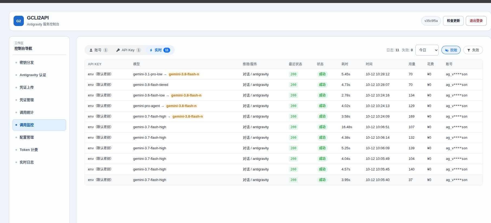

# GeminiCLI to API

**将 GeminiCLI 和 Antigravity 转换为 OpenAI、GEMINI 和 Claude API 兼容接口**

[](https://www.python.org/downloads/)
[](LICENSE)
[](https://github.com/Wzh0718/gcl2api-plus/pkgs/container/gcl2api-plus)

中文 | [English](docs/README_EN.md)

---

## 关于本仓库

本仓库 [Wzh0718/gcl2api-plus](https://github.com/Wzh0718/gcl2api-plus) 基于上游项目 [su-kaka/gcli2api](https://github.com/su-kaka/gcli2api) 二次开发，遵循上游原有许可证。

当前定制版本新增或优化了：

- API Key 签发与管理；
- Antigravity / RT 登录和多账号凭证管理；
- Token 用量、费用和统计模块；
- 账号健康检查、403 复核和额度对账；
- 代理分组、OAuth 客户端和 Redis 计费镜像；
- 流式响应守护、模型参数规范化和模型配额降级链；
- 多架构镜像发布到 GitHub Container Registry（手动触发）。

### 官方镜像

```bash
docker pull ghcr.io/wzh0718/gcl2api-plus:latest
```

日期版本使用 `vYYYYMMDD` 标签，例如：

```bash
docker pull ghcr.io/wzh0718/gcl2api-plus:v20260910
```

本仓库为独立完整项目（无覆盖层、无自动上游同步），开发与发布流程见 [docs/CUSTOMIZATION.md](docs/CUSTOMIZATION.md)。

## 快速部署

### Docker Run

```bash
docker run -d \
  --name gcli2api \
  --network host \
  -e PASSWORD=pwd \
  -e PORT=7861 \
  -v "$(pwd)/data/creds:/app/creds" \
  ghcr.io/wzh0718/gcl2api-plus:latest
```

生产环境建议把 API 和控制面板密码分开：

```bash
docker run -d \
  --name gcli2api \
  --network host \
  -e API_PASSWORD=your_api_password \
  -e PANEL_PASSWORD=your_panel_password \
  -e PORT=7861 \
  -v "$(pwd)/data/creds:/app/creds" \
  ghcr.io/wzh0718/gcl2api-plus:latest
```

### Docker Compose

```bash
docker compose up -d
```

仓库内的 [`docker-compose.yml`](docker-compose.yml) 已默认使用 `ghcr.io/wzh0718/gcl2api-plus:latest`。修改 `.env` 后重新执行 `docker compose up -d`，不需要重新构建镜像。

## 配置建议

先复制示例文件：

```bash
cp .env.example .env
```

| 配置 | 作用 | 默认/建议 |
| --- | --- | --- |
| `API_PASSWORD` | API 端点密码 | 生产环境单独设置 |
| `PANEL_PASSWORD` | 控制面板密码 | 生产环境单独设置 |
| `PASSWORD` | 兼容旧部署的通用密码 | 设置后优先级最高 |
| `CREDENTIALS_DIR` | SQLite 数据库和凭证目录 | `./creds` |
| `PROXY` | 全局代理 | 按需设置 `http` / `https` / `socks5` |
| `REDIS_URL` | 计费镜像和看板加速 | 可选，故障时回退 SQLite |
| `REDIS_USER` / `REDIS_PASSWORD` | Redis 分离认证 | 推荐单独设置 |
| `ANTIGRAVITY_MODEL_FALLBACK_CHAIN` | 配额耗尽时的模型降级链 | 逗号分隔，留空关闭 |
| `MAX_NON_STREAM_BUFFER_BYTES` | 非流响应最大缓冲区 | `16777216` |
| `CREDENTIAL_CANDIDATE_LIMIT` | 单次账号候选上限 | `32` |

配置优先级为：显式环境变量 > `.env` > SQLite 配置 > 代码默认值。SQLite 是唯一的持久化主账本，Redis 只作为计费和看板镜像，不替代 SQLite。

上面只是常用项。全部环境变量（含本 fork 新增的 ★ 标记变量，如 403 复检、网络检查、计费看板等）按功能分组收录在 [环境变量参考](docs/CUSTOMIZATION.md#环境变量参考)；`.env.example` 中每个变量也带默认值注释。

### 模型降级链示例

默认关闭（留空）。需要启用时显式配置，例如：

```dotenv
ANTIGRAVITY_MODEL_FALLBACK_CHAIN=gemini-3.8-flash,gemini-3.8-flash-tiered
```

只有明确的配额耗尽型 429 才会触发降级；图片请求不会自动切换模型。具体配置映射见 [`config.py`](config.py) 和控制面板设置页。

## 控制面板功能展示

### API Key 管理


### RT 与 Antigravity 登录


### 凭证管理优化


### 统计模块


### 设置页优化


### Token 统计


### 调用监控：请求模型 vs 实际执行模型

上游 Antigravity 会把不同请求模型归一到同一物理后端（实测 gemini-3.6/3.7/3.8 各档位、pro-agent 等请求实际均由 `gemini-3.8-flash-n` 执行，响应中的 `modelVersion` 是唯一可信来源）。本仓库在三个层面透出真实执行模型：

- 调用监控「实时」视图逐条显示 `请求模型 → 实际模型`，不一致时高亮实际模型，一致或上游未返回时保持原样；
- OpenAI 兼容（流式/非流式）与 Anthropic Messages 响应附加顶层 `modelVersion` 字段（`model` 仍按协议回显请求名，客户端兼容性不受影响）；
- 每条调用记录（`call_records.upstream_model`）持久化实际上游模型，重启不丢。



### 日志模块优化


## 相关文档

- [English README](docs/README_EN.md)
- [开发与发布指南](docs/CUSTOMIZATION.md)
- [Antigravity 图片 API](docs/ANTIGRAVITY_IMAGE_API.md)
- [账号出口与地区检测方案](docs/ANTIGRAVITY_ACCOUNT_IP_BINDING_PLAN.md)

## 致谢

- 感谢上游项目 [su-kaka/gcli2api](https://github.com/su-kaka/gcli2api)，本仓库在其基础上二次开发，遵循上游原有许可证。
- 感谢 [LINUX DO](https://linux.do) 社区提供的交流与开源推广平台，本项目认可并链接 LINUX DO 社区。

## 免责声明

- 本项目仅供学习与技术研究使用，**严禁用于任何违反 Google 服务条款、上游项目许可证或当地法律法规的用途**。
- 本项目与 Google 无任何关联，并非官方产品；Gemini、GeminiCLI、Antigravity 等名称与商标归其各自权利人所有。
- 使用本项目可能涉及账号限制、封禁、额度扣除等风险，**使用者须自行承担由此产生的一切后果与责任**。
- 本项目按「现状」提供，不附带任何明示或默示的保证；作者不对因使用本项目而产生的任何直接或间接损失承担责任。
- 请勿将本项目用于任何商业转售、批量滥用或侵犯第三方权益的行为。
- 如本项目内容侵犯了您的合法权益，请通过 GitHub Issue 联系，确认后将及时处理。
